# MediMind AI — System Architecture & Technical Specifications

> **Document Status:** IMPLEMENTED & EMPIRICALLY VERIFIED  
> **Last Verified:** September 30, 2026  
> **Current Baseline:** Phase 1–9 Complete | Database Baseline Frozen (0001–0009)  
> **Architectural Standard:** Defense-in-depth, Zero-Trust RLS, Deterministic Safety Invariants

---

## 1. MULTI-TIER SYSTEM ARCHITECTURE

MediMind AI is architected as an asynchronous, decoupled multi-tier clinical intelligence platform:

```
[ Tier 1: Client Layer ]
    │
    ├── Patient Web App (React 18 SPA)
    ├── Doctor Clinical Portal (React 18 SPA)
    ├── Pharmacy Dispensary Workspace (React 18 SPA)
    └── Admin Governance Console (React 18 SPA)
            │
            │ HTTPS (REST / GraphQL / Supabase RPC) + WSS (WebSockets / Signaling)
            ▼
[ Tier 2: Application & API Gateway ]
    │
    ├── Vite Connect Auth Middleware (Local Port 3000 /api/auth/*)
    ├── Supabase Managed PostgREST API Gateway
    └── FastAPI ML Microservice Gateway (Uvicorn Port 8000)
            │
            ├─────────────────────────────────────────┐
            ▼                                         ▼
[ Tier 3: Core Database & Storage ]     [ Tier 4: Clinical AI & ML Service ]
    │                                         │
    ├── Supabase PostgreSQL 15                ├── Symptom Predictor (Random Forest)
    │   ├── 26 Tables                         ├── Deterministic Risk Engine
    │   ├── Frozen Migrations (0001-0009)     ├── Clinical RAG Engine (WHO/ICMR)
    │   ├── 45+ RLS Policies                  ├── Medical Report OCR & Normalizer
    │   └── Transactional RPCs                └── Gemini 3.5 Flash Lite Orchestrator
    │                                                 │
    ├── Supabase Storage Buckets                      │ HTTPS (REST)
    │   ├── medical-documents (Private)               ▼
    │   ├── doctor-documents (Private)          [ Tier 5: External Providers ]
    │   └── pharmacy-documents (Private)              │
    └── Supabase Realtime Channels                    ├── Google Gemini API (AI Studio)
        ├── consultation-{id} (WebRTC)                ├── STUN/TURN (WebRTC Traversal)
        └── notifications-{user_id}                   └── Multi-Channel (Email/SMS/WA)
```

---

## 2. DETAILED LAYER SPECIFICATIONS

### Layer 1: Client Presentation Layer
- **Purpose:** Deliver specialized responsive interfaces for all 4 healthcare personas.
- **Responsibilities:** Client-side state hydration, route protection, interactive vital visualization, WebRTC media rendering.
- **Inputs:** User clicks, form submissions, microphone/camera streams, uploaded PDF/image blobs.
- **Outputs:** Sanitized API payloads, WebRTC SDP offers/answers, rendered UI states.
- **Key Files:** `frontend/src/App.jsx`, `frontend/src/pages/`, `frontend/src/components/`.

### Layer 2: Application & API Gateway Layer
- **Purpose:** Ingress routing, session validation, and privileged onboarding mediation.
- **Responsibilities:** Proxying client requests, handling CORS headers, auto-confirming new dev registrations via `vite-auth-plugin.js`.
- **Inputs:** Client HTTP requests.
- **Outputs:** JSON responses, HTTP status codes, session JWT tokens.
- **Key Files:** `frontend/vite-auth-plugin.js`, `frontend/vite.config.js`.

### Layer 3: Persistence & Storage Layer (Supabase PostgreSQL)
- **Purpose:** Authoritative clinical data store and security boundary.
- **Responsibilities:** ACID transaction execution, anti-double-booking concurrency locks, RLS persona isolation, audit logging.
- **Inputs:** SQL queries, RPC procedure calls, file uploads.
- **Outputs:** Filtered row sets, transaction confirmation receipts, signed storage URLs.
- **Key Files:** `supabase/migrations/0001` through `0009`.

### Layer 4: Clinical AI & Machine Learning Microservice
- **Purpose:** Statistical symptom inference, vital threshold risk evaluation, lab slip extraction.
- **Responsibilities:** Feature vectorization (132 features), Random Forest inference, red-flag emergency detection, RAG retrieval.
- **Inputs:** Symptom array, patient vitals, raw lab PDF/image files.
- **Outputs:** Probabilistic condition list, severity score (0–100), triage tier, normalized biomarker list.
- **Key Files:** `ml-service/main.py`, `ml-service/src/`.

### Layer 5: External Service & Provider Integrations
- **Purpose:** Offloading generative summarization, NAT traversal, and multi-channel delivery.
- **Responsibilities:** Gemini generative explanations, WebRTC peer discovery, SMS/WhatsApp delivery.
- **Security:** Zero private keys exposed to browser; all requests routed server-side or via ephemeral peer tokens.

---

## 3. ARCHITECTURE MERMAID DIAGRAMS

### Diagram 1: High-Level System Architecture

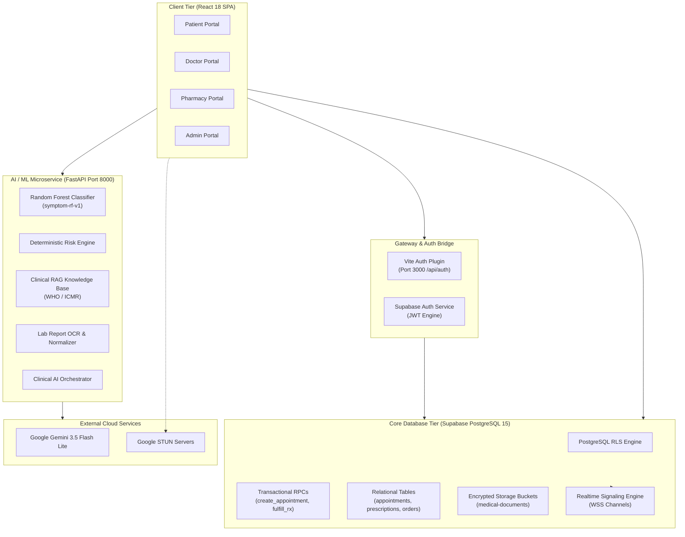

---

### Diagram 2: Patient End-to-End Workflow

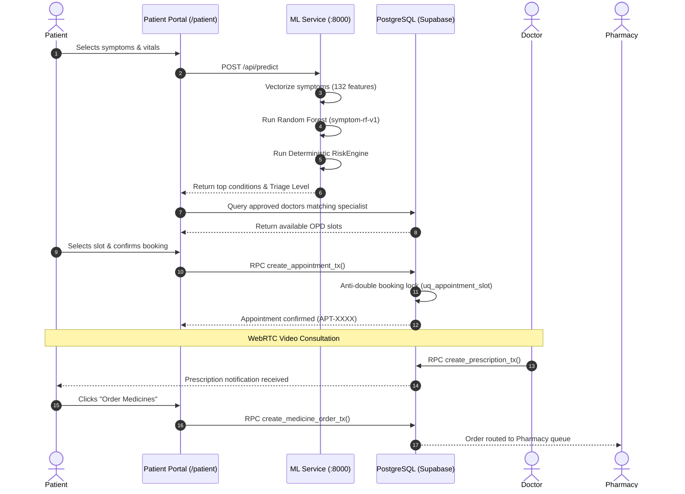

---

### Diagram 3: Doctor Clinical Workflow

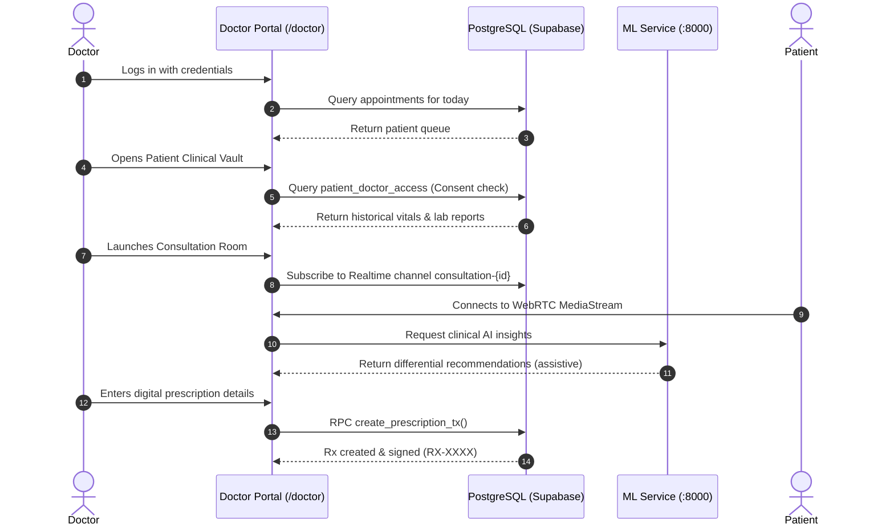

---

### Diagram 4: Pharmacy Dispensary & FEFO Workflow

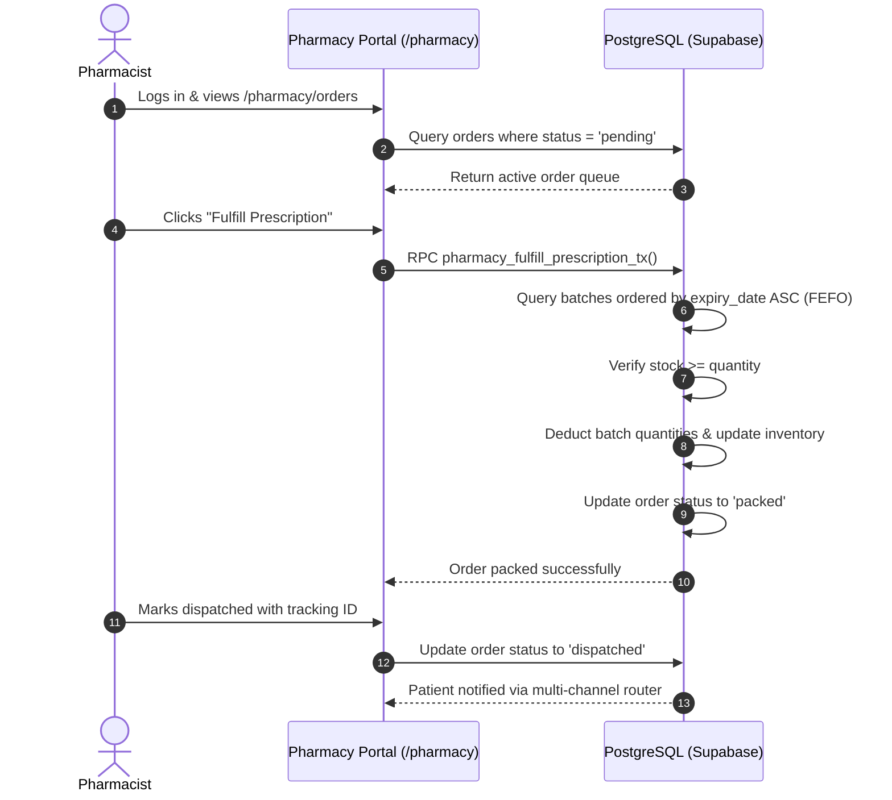

---

### Diagram 5: Administrative Governance Workflow

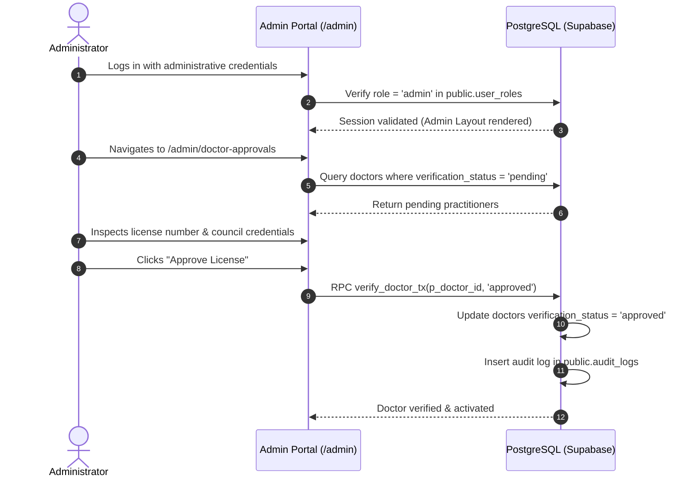

---

### Diagram 6: AI Clinical Triage & Risk Flow

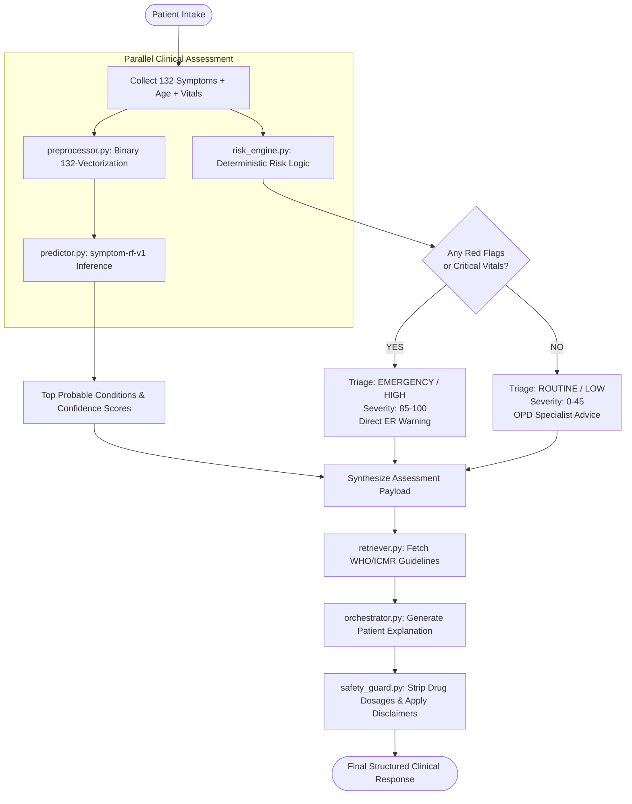

---

### Diagram 7: Medical Report OCR & Biomarker Pipeline

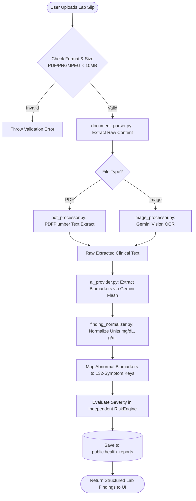

---

### Diagram 8: Multi-Channel Notification Dispatch Flow

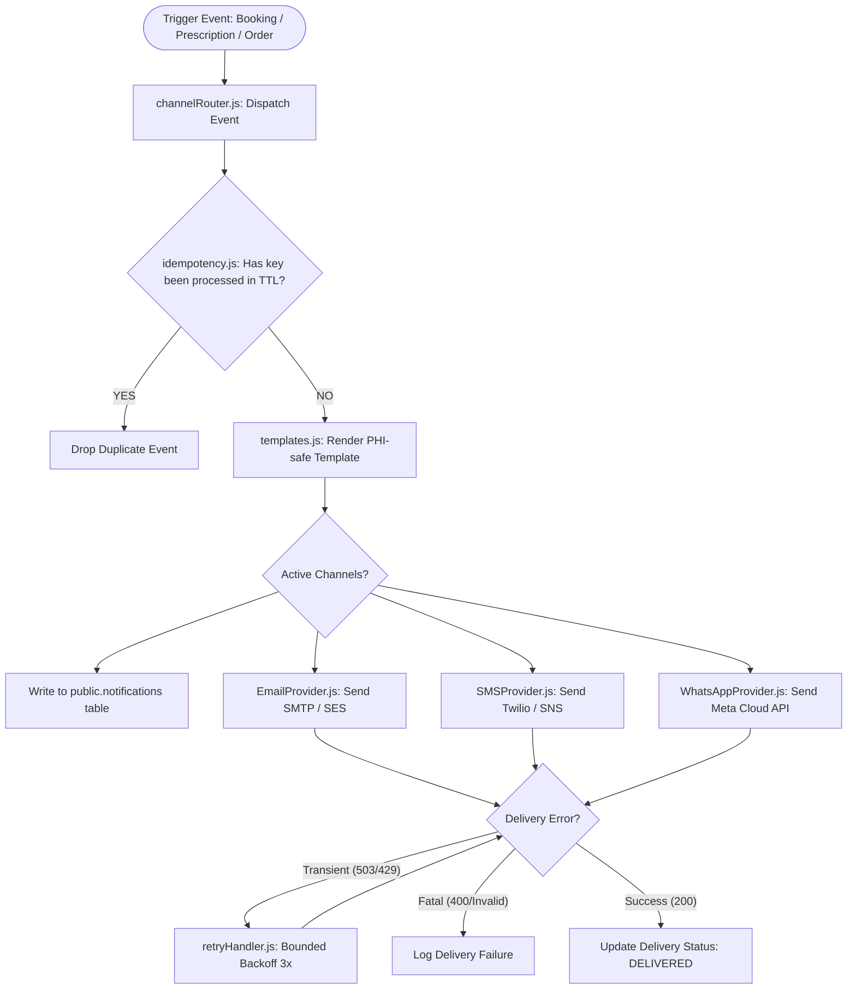

---

### Diagram 9: Authentication & Role Resolution Flow

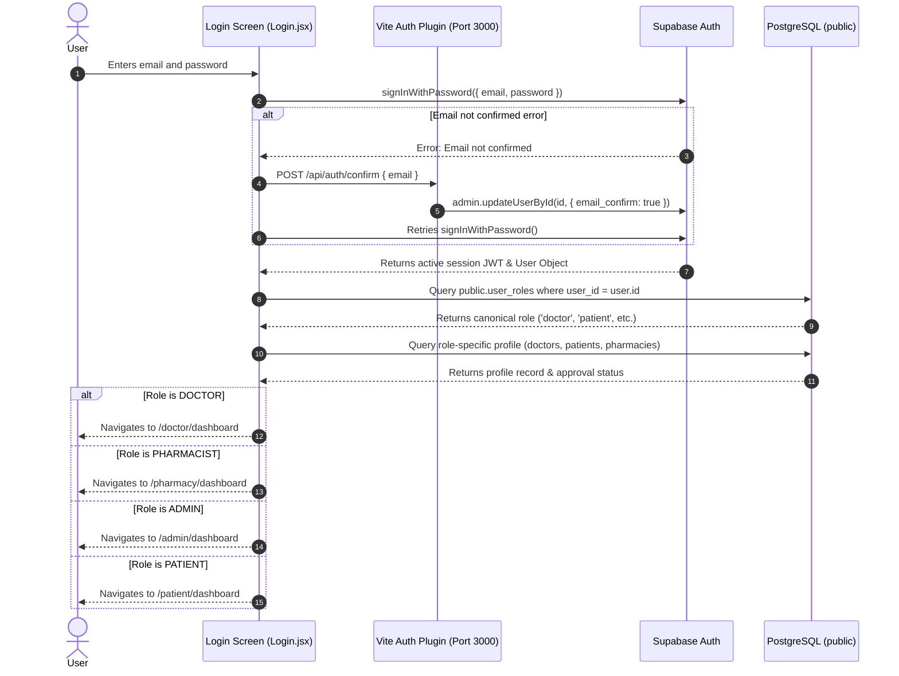

---

### Diagram 10: WebRTC Video Teleconsultation Signaling Flow

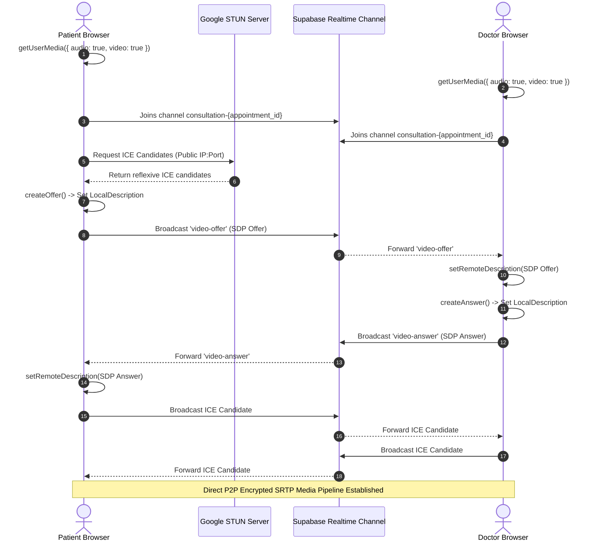

---

### Diagram 11: Database Entity-Relationship Overview

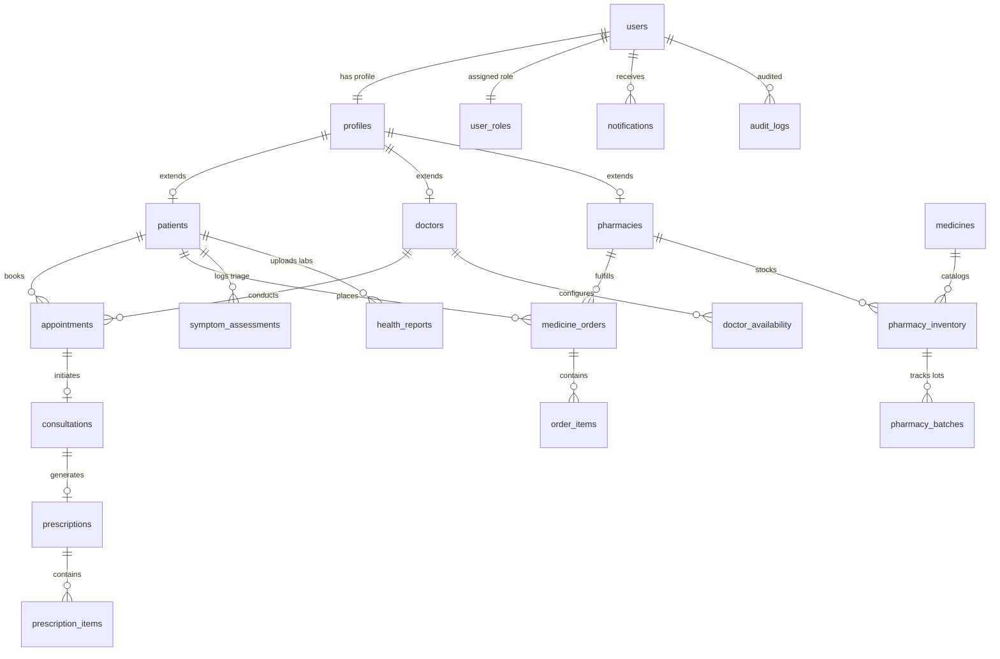

---

### Diagram 12: Request / Response Lifecycle Flow

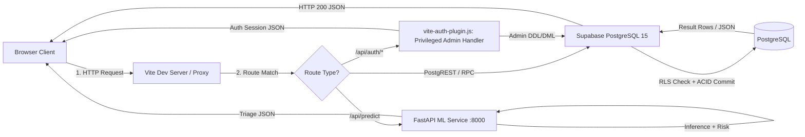
