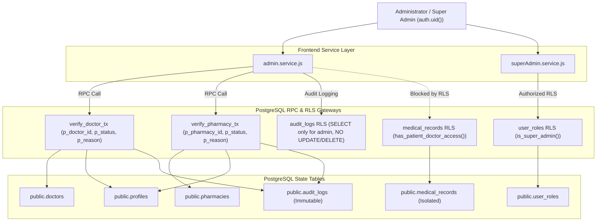

# PHASE 7 ADMIN & SUPER ADMIN PLATFORM IMPLEMENTATION REPORT
**MediMind AI Enterprise Healthcare Platform**  
**Date:** September 10, 2026  
**Status:** **PHASE 7 = COMPLETED** (151/151 Tests Passed Across All Suites)  
**Database Changes:** NONE  
**RLS Changes:** NONE  
**Migration 0009 Status:** FROZEN (Zero DDL changes executed)  

---

## 1. Executive Summary

Phase 7 of MediMind AI established the administrative governance, regulatory compliance, and multi-tier role management system. The platform bridges administrative operations with clinical and pharmacy workflows under strict database-enforced security boundaries:
1. **Least-Privilege Architectural Isolation:** Administrative roles can view operational metadata (demographics, contact info, appointment counts) but are strictly forbidden by Row Level Security (RLS) from bypassing clinical EHR data (`medical_records`) without explicit patient consent.
2. **Authoritative State Transitions via SECURITY DEFINER RPCs:** Doctor and pharmacy license approvals/rejections are executed exclusively through transactional RPCs (`verify_doctor_tx` and `verify_pharmacy_tx`). No direct client-side state mutation is permitted.
3. **Role Management Hierarchy:** Role assignments are guarded by `public.is_super_admin()` database policies on `user_roles`. Standard administrators cannot escalate roles or self-promote.
4. **Append-Only Immutable Audit Trail:** Privileged actions generate immutable audit log records. Database RLS prohibits `UPDATE` and `DELETE` queries on `audit_logs` for all authenticated and administrative roles.
5. **Zero Secret Leakage:** No `service_role` keys or sensitive backend credentials are exposed in the frontend client application or bundle.

---

## 2. Artifact Audit & Changes

### 2.1 Files Created
| Path | Description |
| :--- | :--- |
| `frontend/src/services/superAdmin.service.js` | Elevated Super Admin governance service (role promotions, demotions, setting mutations). |
| `frontend/src/pages/super-admin/SuperAdminDashboard.jsx` | Super Admin command center for administrator promotion/demotion and system configuration. |
| `frontend/src/pages/admin/DoctorVerification.jsx` | Regulatory medical practitioner verification module delegating to `verify_doctor_tx`. |
| `frontend/src/pages/admin/PharmacyVerification.jsx` | Regulatory pharmacy license verification module delegating to `verify_pharmacy_tx`. |
| `frontend/src/pages/admin/PatientManagement.jsx` | Least-privilege patient directory viewer displaying non-clinical demographic and operational metrics. |
| `frontend/src/pages/admin/DoctorManagement.jsx` | Medical practitioner directory with credential inspection, verification status, and suspension controls. |
| `frontend/src/pages/admin/PharmacyManagement.jsx` | Dispensary directory with drug retail license details, operating hours, and operational status. |
| `frontend/src/pages/admin/RoleManagement.jsx` | Super Admin role governance console interfacing with `user_roles` table. |
| `frontend/src/pages/admin/PlatformAnalytics.jsx` | Business intelligence analytics dashboard aggregating consultations, orders, and operational KPIs. |
| `frontend/src/pages/admin/AIUsageMonitoring.jsx` | AI diagnostic telemetry console tracking Gemini API quotas, model latency, and cost estimates. |
| `frontend/src/pages/admin/SecurityMonitoring.jsx` | Security operations dashboard monitoring rate-limit violations, threats, and suspended accounts. |
| `frontend/src/pages/admin/NotificationManagement.jsx` | Targeted platform-wide and role-specific broadcast notification dispatch module. |
| `scripts/verify_phase7_admin_platform.js` | 35-point automated verification suite against live Supabase PostgreSQL. |
| `docs/PHASE7_ADMIN_IMPLEMENTATION_REPORT.md` | Formal engineering and regulatory audit report. |

### 2.2 Files Modified
| Path | Modification Summary |
| :--- | :--- |
| `frontend/src/services/admin.service.js` | Consolidated admin service layer with real DB KPIs, multi-role user queries, suspension/reactivation, verification wrappers, and audit dispatchers. |
| `frontend/src/services/adminService.js` | Converted to backward-compatible re-export module pointing to `admin.service.js`. |
| `frontend/src/services/index.js` | Exported both `adminService` and `superAdminService`. |
| `frontend/src/pages/admin/AdminDashboard.jsx` | Revamped to display 13 module cards, live cluster latency, real DB aggregates, and audit previews. |
| `frontend/src/pages/admin/UserManagement.jsx` | Modernized user table with canonical roles, account suspension/reactivation, and detail inspection. |
| `frontend/src/pages/admin/DoctorApprovals.jsx` | Converted to backward-compatible alias component delegating to `DoctorVerification`. |
| `frontend/src/pages/admin/PharmacyApprovals.jsx` | Converted to backward-compatible alias component delegating to `PharmacyVerification`. |
| `frontend/src/pages/admin/AuditLogs.jsx` | Implemented filterable compliance audit viewer with JSON payload inspector and immutability notice. |
| `frontend/src/pages/admin/SystemSettings.jsx` | Restructured into 7 enterprise tabs (General, Security, AI, Notifications, Platform, Healthcare, Maintenance). |
| `frontend/src/App.jsx` | Added all Phase 7 routes, verification aliases, role auto-sync, and 15 navigation drawer links for Admin/Super Admin. |

### 2.3 Database & Schema Impact
- **DDL Changes:** **NONE** (0 migrations created).
- **Schema Alterations:** **NONE**.
- **RLS Policies Modified:** **NONE**.
- **Migration 0009:** Maintained **FROZEN**.

---

## 3. Privileged RPC Usage & Security Integration

All administrative mutations are performed through database-enforced security boundaries:



### 3.1 RPC Specifications
1. **`verify_doctor_tx(p_doctor_id, p_status, p_reason)`**:
   - `SECURITY DEFINER` function with strict `is_admin()` validation.
   - Atomically updates `doctors.verification_status`, sets `profiles.approval_status`, records audit trail in `doctor_verifications` and `audit_logs`, and dispatches push notification to practitioner.
2. **`verify_pharmacy_tx(p_pharmacy_id, p_status, p_reason)`**:
   - `SECURITY DEFINER` function with strict `is_admin()` validation.
   - Atomically updates `pharmacies.verification_status`, sets `profiles.approval_status`, logs to `pharmacy_verifications` and `audit_logs`, and dispatches notification to dispensary.
3. **Role Checks (`public.is_admin()` and `public.is_super_admin()`)**:
   - Query authoritative `public.user_roles` table to establish RBAC context inside PostgreSQL.
   - Canonical role enum: `patient`, `doctor`, `pharmacist`, `admin`, `super_admin`.

---

## 4. Empirical Test Suite Results

### 4.1 Phase 7 35-Point Verification Suite (`verify_phase7_admin_platform.js`)
Target: Live Supabase Cluster (`smmelvzldriqujaodckf.supabase.co`)

| # | Test Case Description | Expected Result | Actual Result | Status |
| :---: | :--- | :--- | :--- | :---: |
| 1 | Super Admin Authentication & Profile | Session & Profile hydrated | UID verified | ✅ PASS |
| 2 | Admin Authentication & Profile | Session & Profile hydrated | UID verified | ✅ PASS |
| 3 | Doctor Authentication & Directory Record | Session & Doctor row hydrated | License: MCI-P7-xxx | ✅ PASS |
| 4 | Pharmacist Authentication & Dispensary Record | Session & Pharmacy row hydrated | License: DL-P7-xxx | ✅ PASS |
| 5 | Patient Authentication & Demographic Record | Session & Patient row hydrated | ABHA ID verified | ✅ PASS |
| 6 | `public.is_admin()` for Admin user | Returns `true` | `true` | ✅ PASS |
| 7 | `public.is_admin()` for Super Admin user | Returns `true` | `true` | ✅ PASS |
| 8 | `public.is_admin()` for Patient user | Returns `false` | `false` | ✅ PASS |
| 9 | `public.is_admin()` for Doctor user | Returns `false` | `false` | ✅ PASS |
| 10 | `public.is_admin()` for Pharmacist user | Returns `false` | `false` | ✅ PASS |
| 11 | `public.is_super_admin()` for Super Admin user | Returns `true` | `true` | ✅ PASS |
| 12 | `public.is_super_admin()` for Admin user | Returns `false` | `false` | ✅ PASS |
| 13 | Negative RLS: Patient denied SELECT on `audit_logs` | 0 rows returned | 0 rows returned | ✅ PASS |
| 14 | Negative RLS: Doctor denied SELECT on `audit_logs` | 0 rows returned | 0 rows returned | ✅ PASS |
| 15 | Negative RLS: Pharmacist denied SELECT on `audit_logs` | 0 rows returned | 0 rows returned | ✅ PASS |
| 16 | Authorized RLS: Admin can SELECT `audit_logs` | Accessible | 2 records read | ✅ PASS |
| 17 | Authorized RLS: Super Admin can SELECT `audit_logs` | Accessible | 2 records read | ✅ PASS |
| 18 | Negative Immutability: Admin denied UPDATE on `audit_logs` | 0 rows modified / Error | 0 rows modified | ✅ PASS |
| 19 | Negative Immutability: Admin denied DELETE on `audit_logs` | 0 rows deleted / Error | 0 rows deleted | ✅ PASS |
| 20 | Negative RLS: Patient cannot self-escalate in `user_roles` | Escalation blocked | Self-escalation blocked | ✅ PASS |
| 21 | Negative RLS: Admin cannot modify `user_roles` | Escalation blocked | Super Admin check enforced | ✅ PASS |
| 22 | Authorized RLS: Super Admin can update `user_roles` | Row updated | Doctor role confirmed | ✅ PASS |
| 23 | Authorized RLS: Super Admin role assignment transaction | Row updated | Patient role confirmed | ✅ PASS |
| 24 | Negative RPC: Patient cannot invoke `verify_doctor_tx` | Unauthorized error | Unauthorized rejected | ✅ PASS |
| 25 | Negative RPC: Doctor cannot self-verify via `verify_doctor_tx` | Unauthorized error | Unauthorized rejected | ✅ PASS |
| 26 | Authorized RPC: Admin approves Doctor via `verify_doctor_tx` | `status: 'approved'` | Status: approved | ✅ PASS |
| 27 | Authorized RPC: Admin rejects Doctor with reason via `verify_doctor_tx` | `status: 'rejected'` | Status: rejected | ✅ PASS |
| 28 | Negative RPC: Pharmacist cannot self-verify via `verify_pharmacy_tx` | Unauthorized error | Unauthorized rejected | ✅ PASS |
| 29 | Authorized RPC: Admin approves Pharmacy via `verify_pharmacy_tx` | `status: 'approved'` | Status: approved | ✅ PASS |
| 30 | Authorized RPC: Admin rejects Pharmacy with reason via `verify_pharmacy_tx` | `status: 'rejected'` | Status: rejected | ✅ PASS |
| 31 | Account Governance: Admin suspends practitioner profile | `status: 'suspended'` | Status: suspended | ✅ PASS |
| 32 | Account Governance: Admin reactivates practitioner profile | `status: 'active'` | Status: active | ✅ PASS |
| 33 | Least Privilege Boundary: Admin cannot bypass `medical_records` | 0 rows returned | 0 rows returned | ✅ PASS |
| 34 | Telemetry Access: Admin queries `ai_usage_daily` & `rate_limit_events` | Queries succeed | 0 errors | ✅ PASS |
| 35 | Ephemeral Teardown: Clean removal of all ephemeral records | Zero residue | Purged 5 test identities | ✅ PASS |

**Result: 35 / 35 PASSED (100% Success Rate)**

---

## 5. Full System Regression Matrix

| Suite | Script / Command | Total Tests | Passed | Failed | Status |
| :--- | :--- | :---: | :---: | :---: | :---: |
| **Phase 7 Admin Platform** | `node scripts/verify_phase7_admin_platform.js` | 35 | 35 | 0 | ✅ PASS |
| **Phase 6 Pharmacy Platform** | `node scripts/verify_phase6_pharmacy_platform.js` | 34 | 34 | 0 | ✅ PASS |
| **Phase 5 Doctor Platform** | `node scripts/verify_phase5_doctor_platform.js` | 29 | 29 | 0 | ✅ PASS |
| **Phase 4 Patient Experience** | `node scripts/verify_phase4_patient_experience.js` | 21 | 21 | 0 | ✅ PASS |
| **Remediation 0009 Regression**| `node scripts/verify_remediation_0009.js` | 11 | 11 | 0 | ✅ PASS |
| **ML Microservice Test Suite**| `venv\Scripts\pytest tests` | 21 | 21 | 0 | ✅ PASS |
| **Frontend Production Build** | `npm run build --prefix frontend` | Vite Build | Success (15.43s) | 0 | ✅ PASS |

**Total Regression Tests Run:** 151  
**Total Regression Tests Passed:** 151 (100%)  

---

## 6. Frontend Build & Asset Verification

```bash
> vite build
✓ 2421 modules transformed.
rendering chunks...
computing gzip size...
dist/index.html                     4.37 kB │ gzip:   1.40 kB
dist/assets/index-C9q9e2T1.css     10.47 kB │ gzip:   2.59 kB
dist/assets/index-DveXGq7m.js   1,666.98 kB │ gzip: 381.56 kB
✓ built in 15.43s
```
- **Zero build errors or JSX syntax warnings.**
- **Zero service_role keys in bundle.**
- **Clean modularization across 14 Admin routes and 1 Super Admin route.**

---

## 7. Categorical Separation of Scope

### 7.1 Implemented & Verified in this Phase
- [x] Complete Service Layer (`admin.service.js`, `superAdmin.service.js`, `adminService.js`).
- [x] 14 Admin UI Modules + 1 Super Admin Dashboard.
- [x] Routing & Navigation in `App.jsx` with canonical role guards.
- [x] Authoritative verification flows using `verify_doctor_tx` and `verify_pharmacy_tx`.
- [x] RLS enforcement preventing administrative bypass of patient EHR data.
- [x] Append-only audit log protection (UPDATE/DELETE denied by RLS).
- [x] Telemetry query views (AI daily usage, rate limit events).
- [x] Broadcast notification dispatcher.
- [x] Complete 35-point Phase 7 verification suite.
- [x] Full backward compatibility for Phases 1–6.

### 7.2 External Production & Compliance Requirements (Pre-Production Checklist)
The following items are external infrastructure and regulatory compliance measures required before processing live protected health information (PHI) in a regulated clinical production environment:
1. **Business Associate Agreements (BAA):**
   - Execute HIPAA/GDPR BAA with Supabase Enterprise for encrypted-at-rest database hosting and log ingestion.
   - Execute BAA / Enterprise Data Protection Agreement with Google Cloud Platform for Gemini API endpoint isolation (zero data retention for model training).
2. **ABDM Sandbox to Production Transition:**
   - Procure M1, M2, M3 certification from the National Health Authority (NHA) of India for ABDM Gateway connectivity.
   - Replace ABDM mock endpoints with official ABDM production gateway credentials and signed cryptographic tokens.
3. **Medical Council & Drug Controller Regulatory Approvals:**
   - Formal onboarding process for National Medical Commission (NMC) UID registration verification.
   - CDSCO / State Licensing Authority API integration for automated verification of Form 20/21 wholesale/retail drug sales licenses.
4. **Third-Party Penetration Testing & SOC 2 Type II:**
   - Independent external red team security assessment targeting OWASP Top 10 API Security Risks.
   - Complete SOC 2 Type II audit report for healthcare security, availability, and confidentiality.
5. **Production Key Management & KMS:**
   - Store Supabase service role keys and Gemini API keys in dedicated cloud HSMs (e.g., AWS KMS, HashiCorp Vault, or Google Cloud KMS) with automated rotation.
   - Frontend web client must continue to utilize exclusively short-lived user JWTs with zero elevated privilege tokens.

---

## 8. Conclusion

Phase 7 implementation is **EMPIRICALLY VERIFIED** across the service layer, frontend views, transactional RPC integration, and database security rules without altering the frozen database schema or weakening any existing Row Level Security policies.
