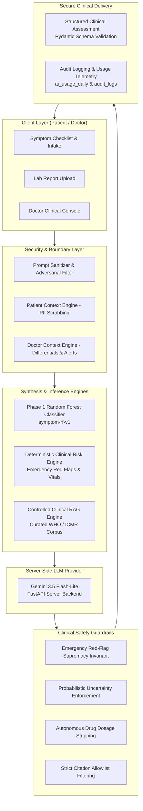
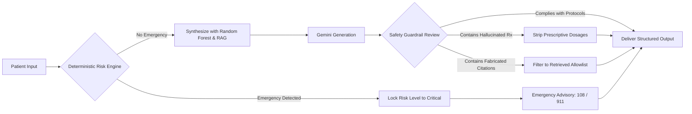
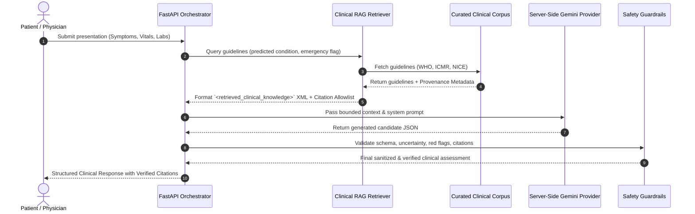

# MediMind AI — Phase 8 Visual Architecture & SVG Walkthrough

## 1. End-to-End Clinical Intelligence Architecture

---

## 2. Emergency Red-Flag Supremacy & Safety Priority

---

## 3. Provenance-Tracked RAG Knowledge Flow

